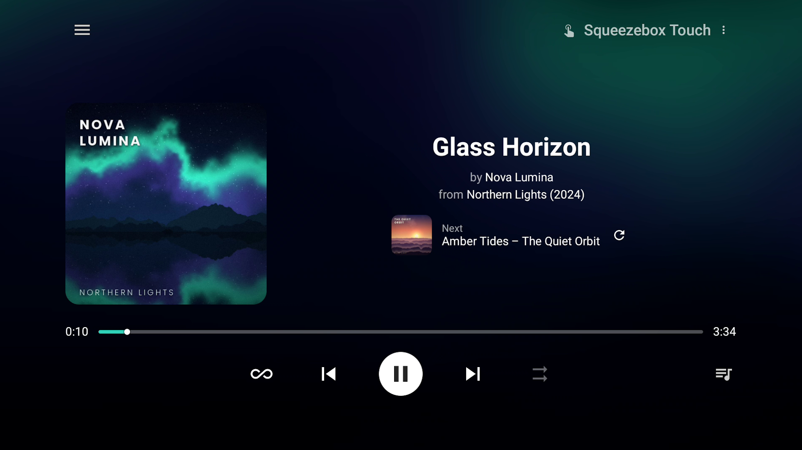

# Logitech Media Server Now Playing
Android TV app to show the current playing song from your Logitech Media Server (Lyrion) instance.

If you have a Jellyfin instance, you can provide the credentials to grab the backdrop image. Otherwise it defaults to showing the album art.

|  | 
|:--:| 
| *Now Playing screen (falls back to the blurred album cover if Jellyfin isn't configured)* |

## Features

- Runtime settings screen — configure your Lyrion (and optional Jellyfin) server directly in the app, no rebuild needed.
- Remembers a default player (Settings → Default player) and auto-connects to it on startup, so a Harmony-launched activity is ready to go without picking a player by hand. Optional "Only control default" hides the player list and always controls that player.
- Material-style Now Playing screen with a progress bar (counting along every second) and position dot, play/pause, previous/next, shuffle (songs / releases) and repeat (queue / one song / Don't Stop The Music).
- Library browser (☰): a "My Music" section (search, artists with A–Z jump, albums, tracks, genres, music folder, favorites, playlists) with cover art, and it remembers the section you were in. Play now, play next or add to the queue.
- Library search shows artist and album with every result, plus the matching track under an album; long lines scroll by themselves.
- Radio menu: browse and search your Lyrion radio plugins (TuneIn, RadioTunes, ...) and play stations. Radio Now Playing appears at the top when it is installed.
- Icons throughout the menus, player list and settings, with a player-type icon (Squeezelite, Boom, Touch, ...) in the header, and a scroll indicator on long lists.
- Queue panel: see what is queued, jump to a track or remove it.
- Mix menu: switch the Auto Mix plugins SugarCube, MIPster, Random Flow and Lyrion's Random Mix on or off, and start a new mix or a batch. While a stream plays, a start-mix button on the Now Playing screen starts a mix right away.
- Shows a preview of the next track under the currently playing one.
- "Replace next track" button that picks a new upcoming track: uses the active mix plugin's own replace action (SugarCube, MIPster or Random Flow), otherwise a legitimate Don't Stop The Music trigger, and falls back to a random track from the same genre/artist if none of those is available. Hidden while a stream or batch plays.
- Local player: start and stop SB Player or Squeezelite on the device LMSNP runs on, from Settings and the ⋮ menu (see Local player below). Offline players are hidden from the player list.
- English and Dutch interface, following the language of the device.
- Correct standby/exit handling (via Back press or a Harmony activity's standby button), including waking self-powered or software players like Squeezelite — works great as a Squeezelite companion.
- Resilient to network hiccups: a temporarily unreachable server/player (e.g. one that's still waking up) no longer crashes the app.

## Volume

**Volume buttons.** Where the volume buttons of your remote go is something you set up on your Android or Google TV device (such as an Nvidia Shield). They can go to the device itself, or to your TV or receiver through infrared or HDMI-CEC. LMSNP can only use the volume buttons that reach the device it runs on. If the volume goes to another device through infrared or HDMI-CEC, LMSNP never sees the key presses. Then control the volume with the remote of the TV or whichever other device plays the sound (receiver, soundbar, active speakers).

**The slider.** The slider sets the volume the player sends out. How loud it actually gets also depends on the volume setting of the device that plays the sound: your TV, receiver, amplifier, soundbar or active speakers. The slider only shows for players whose volume can be changed, so not for players that are fixed at 100%. Press Down from the player buttons to reach it.

**SB Player.** SB Player cannot be fixed at 100% volume, so its slider works within the volume of the device that plays the sound. If you already control that volume with your remote, the slider adds little. You can hide it: in Settings, open Local player and untick Volume slider (this option shows when SB Player is the local player). The volume buttons are not affected by this.

**Control device volume.** A switch in Settings → Local player. The slider and the volume buttons then control the volume of the Android or Google TV device itself instead of Lyrion's volume. The device volume moves in the steps of the device: a TV with 2% steps rounds the slider value to its nearest step. The slider follows the real volume with up to about 2 seconds delay, so after fast presses (or with a receiver in between) it can lag for a moment and then corrects itself.

**Squeezelite and fixed volume.** "Fixed volume 100% (Lyrion)" in Settings → Local player sets your Squeezelite in Lyrion to a fixed 100% output level. There is then no slider and the device decides the volume. LMSNP sends this choice every time your Squeezelite connects, also when the box is unticked (it then sets a variable volume), so a fixed setting made by hand in Lyrion is undone unless the box is ticked. If your Squeezelite is not connected yet, the choice is sent as soon as it connects. In my tests on an Nvidia Shield, with a variable volume Lyrion's volume followed the slider but I heard no change.

**What has been tested** (a player playing through an amplifier or receiver):
- *Volume over HDMI-CEC:* the slider has no effect.
- *Volume over infrared:* the slider can lower the volume, but cannot raise it above the receiver's own setting. Other apps behave the same way.
- *Denon/Marantz AVR Control plugin:* works well. If you set a volume limit in the plugin, the slider still shows 0-100% of that range, and the plugin enforces the limit.
- *SB Player on an Nvidia Shield with Bluetooth speakers:* the volume buttons of the remote control the volume of the Shield. The slider works within the volume set on the speakers.
- *SB Player as local player on a Google TV with a soundbar (HDMI-CEC), Control device volume on:* the slider has the scale of the TV and follows it roughly. The volume buttons of the soundbar change the TV volume, and the slider follows. With Control device volume off, the slider works within the volume of the TV.
- *Squeezelite as local player on the same TV:*

  | Control device volume | Fixed volume 100% | Result |
  |---|---|---|
  | off | off | The slider works and follows the TV volume, roughly in sync |
  | on | off | The same as above |
  | off | on | No slider, the volume of the TV is what it is |
  | on | on | A slider only shows if Squeezelite's own settings sync the volume with Lyrion, and it lags behind the TV when you press fast |

**A warning.** Don't turn up the volume of your TV, receiver or speakers to make up for a low slider: other sources will then play far too loud. Be careful with the slider at 0 as well: you hear nothing, which invites you to turn up the volume of the device that plays the sound. Set that device once to a level that suits all your sources, and use the slider only to go quieter.

## Local player

LMSNP can start and stop a player app on the Android or Google TV device it runs on, so the device plays your Lyrion music itself. Choose it in Settings → Local player.

**Player apps** (Android / Google TV)
- **Squeezelite** – free: [F-Droid](https://f-droid.org/packages/org.lyrion.squeezelite) · [GitHub](https://github.com/CDrummond/squeezelite)
- **SB Player** – [Google Play](https://play.google.com/store/apps/details?id=com.angrygoat.android.sbplayer) (paid app)

Both work with LMSNP. I prefer Squeezelite: it is free, finds your server by itself on the same network, and its volume can be fixed at 100% in Lyrion. SB Player needs to be started once from its own app and set up for your server, and is a paid app. Tested on an Nvidia Shield and one other Google TV.

**First use.**
- *SB Player:* start it once from its own app and point it at your Lyrion server. It remembers the server after that, and only then can LMSNP start it.
- *Squeezelite:* finds your Lyrion server by itself on the same network. On another network or over a VPN (for example Tailscale) it cannot: enter the server address in Squeezelite's own settings.

**Settings → Local player.**
- *None / SB Player / Squeezelite:* the app you use.
- *Auto-start:* LMSNP starts the player itself, also each time you come back to the app. With Auto-start on, the "Start local player" entry is not in the ⋮ menu.
- *Stop on exit:* stops the player app when you close LMSNP.
- *Control device volume:* see Volume.
- *Volume slider* (SB Player only): show or hide the slider.
- *Fixed volume 100% (Lyrion)* (Squeezelite only): see Volume.

**Start / stop from the menu.** With Auto-start off, the ⋮ menu has "Start local player" or "Stop local player". LMSNP decides whether the player runs from Lyrion's player list (the type of player and the IP address of this device). If Lyrion sees the device under another address (NAT, a VPN), the entry can say "Start" while the player is running.

**Player list.** Offline players are not shown. The list refreshes every 10 seconds, and every 2 seconds after starting a local player. If the player you control goes offline, LMSNP shows "No Player" until it is back.

**Default player.** Settings → Default player opens a list of the connected players; "None" clears it. LMSNP selects the default player when it is connected. A default player that is offline is not selected: it is picked as soon as it connects. The switch "Only control default" in the same list (it needs a default player) hides the player list in the ⋮ menu: LMSNP then always controls the default player, and shows "No Player" while it is offline. Other players in Lyrion are not affected.

# Installing without building

Prebuilt APKs are published on the [Releases page](https://github.com/HB64/lms-nowplaying/releases) — download the `.apk` from the latest release and install it via `adb install` or a file manager/sideload app on your Android TV device. After install, fill in your Lyrion (and optional Jellyfin) server details on the in-app settings screen — no `local.properties` or rebuild required.

# Building the Source
*Project currently builds with Kotlin 2.2.21, AGP 8.1.2, and Jellyfin SDK 1.8.11 (see `gradle/libs.versions.toml`).*

1. Clone the repo and open it in Android Studio.
2. Change the build variant to `release` (or use `debug` while developing).
3. In Android Studio: Build → Generate App Bundles or APKs → Generate APKs.
4. Install the APK on your Android TV device (e.g. Nvidia Shield) via `adb install` or by running it directly from Android Studio with the device selected.

## Jellyfin compatibility — important

The Jellyfin SDK version pinned in `gradle/libs.versions.toml` (`jellyfin-sdk`) must roughly match your Jellyfin **server** version, or authentication and artist-image lookups will fail or crash at runtime. Check your server version in Jellyfin under *Dashboard → General*, then pick a matching SDK release from the [jellyfin-sdk-kotlin releases page](https://github.com/jellyfin/jellyfin-sdk-kotlin/releases) — each release lists its "Recommended API Version". As of this writing, SDK `1.8.11` targets Jellyfin server `10.11.x`.

If you bump the SDK version and hit build or runtime errors, these are the two we've already run into:
- **Runtime crash: `NoClassDefFoundError: org.slf4j.LoggerFactory`** — the SDK logs via `kotlin-logging`, which needs an SLF4J binding on the classpath that isn't pulled in automatically. Fixed by adding `implementation(libs.slf4j.nop)` (a no-op logger) to `app/build.gradle.kts`. Already present in this repo, but worth knowing about if you fork/reset.
- **Compile error: `Unresolved reference 'get'` on `SearchApi`** — newer SDK versions renamed `SearchApi.get(...)` to `SearchApi.getSearchHints(...)` (same parameters). Already updated in `JellyfinApi.kt`.
- Bumping the Jellyfin SDK also generally requires a recent Kotlin version (2.2.x+) and the `org.jetbrains.kotlin.plugin.compose` Gradle plugin instead of the old `composeOptions.kotlinCompilerExtensionVersion` setup — both already configured in this repo.

## Configuration

Server URLs and credentials are set on the in-app settings screen (Lyrion, and optionally Jellyfin) and stored on the device only (DataStore). Nothing is compiled into the APK, so no `local.properties` or rebuild is needed.

# Credits

- Based on [LMS-NowPlaying](https://github.com/TroyFernandes/LMS-NowPlaying) by Troy Fernandes, written when the server was still called Logitech Media Server.
- Icons: [Material Design Icons](https://pictogrammers.com/library/mdi/) by Pictogrammers, licensed under the [Apache License 2.0](https://www.apache.org/licenses/LICENSE-2.0).
